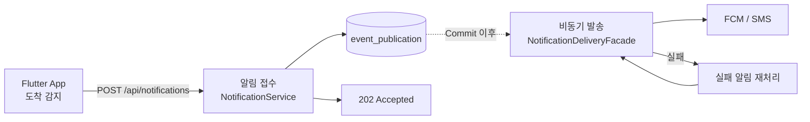

# ImHere Server

출발·도착 같은 상태 변화를 친구·가족에게 **자동으로 알려 주는** 서비스의 서버입니다.

Flutter 앱이 보낸 이벤트를 인증하고, 친구 관계와 수신 권한을 확인한 뒤, FCM 푸시와 SMS로 전달하고 그 결과를 관리합니다.

> 랜딩 페이지 : https://imhere.ratiko.co.kr

> API 문서 : https://imhere.ratiko.co.kr/swagger-ui/index.html

> 모바일 레포지토리 : https://github.com/ImHereOfRati/mobile

> 플레이 스토어 : https://play.google.com/store/apps/details?id=com.kdongsu5509.iamhere

---

<p>
  
  
  
  
  
</p>
<p>
  
  
  
  
  
  
</p>
<p>
  
  
  
  
</p>
<p>
  
  
  
  
  
  
  
</p>

---

## 1. 문제

서울에서 거제로 이동하면서 가족에게 "이제 출발한다", "도착했다"를 계속 알려야 했는데, 이동 중에 그걸 놓쳤습니다. 여기서 문제를 이렇게 정리했습니다.

- 출발·도착 같은 상태를 **사람이 직접 연락하지 않아도** 상대에게 닿아야 한다.
- 상대가 앱을 쓰지 않을 수도 있다. 그래도 알림은 가야 한다.
- 위치를 계속 들여다보는 서비스는 원하지 않는다. 필요한 건 **사건이 일어난 순간의 통지**다.

### 핵심 요구사항

1. 출발·도착 이벤트를 받아 정해진 사람에게 알린다.
2. 전달 수단은 FCM(앱 푸시)과 SMS 두 가지다.
3. 같은 사건으로 알림이 두 번 가면 안 된다.
4. 외부 메시징 공급사(Firebase, Solapi)가 느려지거나 실패해도 서비스 전체가 같이 무너지면 안 된다.
5. 비용이 실제로 나가는 SMS는 한 사람이 무제한으로 쏘지 못하게 막아야 한다.
6. 친구가 아닌 사람에게는 알림이 가지 않아야 한다.

---

## 2. 기술 및 아키텍처


운영은 EC2 한 대 위에서 컨테이너 세 개가 돕니다. `nginx`가 외부 트래픽을 받고, Spring Boot 애플리케이션이 모든 도메인 로직을 한 JVM에서 처리하며, Grafana Alloy가
로그·메트릭·트레이스를 수집해 Grafana Cloud로 보냅니다.

### 기술 스택

| 분류                 | 기술                                                                 |
|--------------------|--------------------------------------------------------------------|
| Language / Runtime | Kotlin 2.3.21, JDK 25                                              |
| Framework          | Spring Boot 4.1.0, Spring Modulith 2.1.0                           |
| Build              | Gradle Wrapper 9.3.1, KSP 2.3.7                                    |
| DB                 | MySQL, Spring Data JPA, QueryDSL 7.4.0                             |
| Cache / Rate Limit | Caffeine 3.1.8, Bucket4j 8.19.0                                    |
| Auth               | Google·Kakao·Apple OIDC, JJWT 0.12.6, Spring Security              |
| Push / SMS         | Firebase Admin SDK 9.8.0, Solapi SDK 1.1.0                         |
| API Docs           | Spring REST Docs → OpenAPI 3 → Swagger UI                          |
| Observability      | Actuator, Micrometer, OpenTelemetry, Grafana Alloy → Grafana Cloud |
| Test               | JUnit 5, Mockito, MockMvc, H2(MySQL 모드), JaCoCo                    |
| Infra              | AWS EC2·ECR·CloudFormation, Docker, nginx, GitHub Actions          |
| Load Test          | k6                                                                 |

### 모듈 구조

Gradle 프로젝트는 하나이고, 여기서 말하는 모듈은 **Spring Modulith 애플리케이션 모듈**(패키지 경계)입니다.

```text
com.kdongsu5509
├── auth            인증: OIDC 검증, JWT 발급·갱신, Security 필터 체인, 관리자 로그인
├── user            사용자: 등록·조회·활성화·차단·탈퇴
├── friends         친구 관계: 요청·수락·거절·별칭·제한
├── notifications   알림: 접수 → 상태 관리 → FCM/SMS 발송 → 실패 복구
├── terms           약관 원문과 버전
├── agreement       사용자의 약관 동의 이력
├── maps            네이버 지도 API 프록시
├── admin           운영 상태 모델 (OPEN 모듈)
├── shared          공통 응답·이벤트·캐시 포트 (OPEN 모듈)
└── support         설정·예외·로깅·Discord 경보·비동기 실행기 (OPEN 모듈)
```

모듈 경계는 문서가 아니라 테스트(`ModularityTest`)가 지킵니다. 순환 의존이나 허용되지 않은 접근이 생기면 **빌드가 먼저 실패**합니다.

### 핵심 흐름 — 도착 알림

접수와 발송이 분리돼 있다는 점이 이 서비스의 중심입니다.



- 사용자는 외부 발송 결과를 기다리지 않고 `202`를 받습니다.
- 발행 기록(`event_publication`)이 업무 데이터와 **같은 트랜잭션**에 남아, 데이터만 저장되고 알림이 증발하는 상황이 없습니다.
- `dedupeKey`로 중복 발송을 막고, 실패분은 60초 주기 복구 스케줄러가 회수합니다.

```text
PENDING ──claim──► PROCESSING ──성공──► SENT
                        │
                        ├──실패(재시도 여지)──► FAILED ──재시도 3회 초과──► DEAD
                        └──결과 불확실──────► UNKNOWN
```

### 인증과 인가

- 앱이 소셜 SDK로 받은 **ID Token**을 서버가 검증합니다. Authorization Code 교환은 하지 않습니다.
- Access Token 12시간 / Refresh Token 7일, 회전은 CAS로 처리합니다.
- 인가는 세 겹입니다 — ① 필터 체인(로그인·권한) → ② 사용자 상태 `ACTIVE` 확인 → ③ 각 서비스의 소유권 검증.
- 관리자 로그인은 비밀번호 해시 + TOTP 2단계이며, 5회 실패 시 7일간 차단합니다.

자세한 내용은 [서버 아키텍처](docs/imhere-architecture.md)와 [Security](docs/security.md)에 있습니다.

---

## 3. 실행 및 배포

### 로컬 실행

필요 환경 : `JDK 25`와 `MySQL 8`입니다.

```bash
# 1. 스키마 준비
mysql -h 127.0.0.1 -u root -p rati < db/init/mysql/imhere-full-init.sql

# 2. 실행 (프로파일 인자 없이 application.yaml 기본값으로 뜹니다)
./gradlew bootRun

# 3. 테스트 (H2 MySQL 모드, 별도 DB·Docker 불필요)
./gradlew test
```

- 뜬 뒤 `http://localhost:8080/swagger-ui/index.html`에서 API 문서를 볼 수 있습니다.
- OpenAPI 문서는 **테스트 스니펫에서 생성**됩니다. REST Docs를 쓰지 않은 엔드포인트는 Swagger에 나타나지 않습니다.
- `./gradlew test`가 끝나면 JaCoCo 리포트가 함께 생성됩니다.

### 배포

`main`에 push하면 GitHub Actions가 처리합니다.

```text
main push
  → 테스트 + bootJar
  → 이미지 태그 생성 (20260915-2131-b969557 = KST 시각 + short SHA)
  → CloudFormation 출력값에서 배포 대상 조회
  → private config 저장소에서 env/*.env, Firebase 키 확보
  → Dockerfile.release로 빌드 → ECR push
  → SSH 배포 (설정 전송 → 컨테이너 교체 → TLS 발급)
  → 헬스체크 통과해야 성공
```

- 배포 중에만 SSH 포트를 러너 IP로 열고, 실패해도 **회수 단계가 항상 실행**됩니다.
- `docker compose up -d`는 컨테이너 생성만 보장하므로, 별도 헬스체크가 실제 응답(`"status":"UP"`)을 확인한 뒤에야 배포를 성공으로 판정합니다.
- 운영 프로파일은 민감한 환경변수를 **기본값 없이** 선언합니다. 값이 빠지면 로컬 더미로 조용히 뜨는 대신 기동에 실패합니다.
- 무중단 배포와 자동 롤백은 없습니다. 한계는 [배포와 운영](docs/imhere-deployment-and-operation.md)에 적어 두었습니다.

### 부하 테스트

AWS에 일회용 환경을 만들고, k6를 돌리고, 끝나면 리소스를 지웁니다.

```bash
./loadtest/run-loadtest.sh
```

실행 옵션은 [`loadtest/README.md`](loadtest/README.md), 측정 결과와 병목 분석은 [부하 테스트와 성능 검증](docs/loadtest.md)에 있습니다.

---

## 4. ADR

각 선택은 **얻은 것과 치른 값**을 함께 적습니다. 판단 근거 전문은 [서버 아키텍처](docs/imhere-architecture.md)에 있습니다.

| 판단                                     | 이유                                                                          | 치른 값                                           |
|----------------------------------------|-----------------------------------------------------------------------------|------------------------------------------------|
| **위치를 서버가 추적하지 않는다**                   | 위치 공유는 법적 신고 대상이고 심사도 까다로움. 서버 처리량이 사용자 수에 종속됨. 서비스에 필수 기능도 아니었음            | 앱의 판정을 서버가 검증할 수 없음                            |
| **메시지 브로커를 쓰지 않는다**                    | 사용자 10명 미만, 인스턴스 1대. Modulith Event Publication Registry가 Outbox와 같은 보장을 제공 | 다중 인스턴스 전환 시 중복·순서·소유권 재설계 필요. 이벤트마다 DB 쓰기가 발생 |
| **Redis 대신 Caffeine 로컬 캐시**            | 인스턴스 1대로 충분. 읽기 속도를 올리면서 인프라 비용 제거                                          | 확장 시 refresh 회전·SMS 한도·관리자 차단 로직을 전부 수정해야 함    |
| **알림 접수와 발송 분리 (202)**                 | 외부 공급사 지연을 사용자 응답 시간에서 떼어내기 위해                                              | 응답 시점에 최종 발송 성공을 보장하지 않음. 상태 머신과 복구 경로를 직접 운영  |
| **외부 호출을 트랜잭션 밖으로**                    | 공급사가 느려질 때 DB 커넥션이 묶이는 것을 막기 위해                                             | 트랜잭션이 쪼개져 중간 실패 시 상태가 어중간하게 남음(복구 스케줄러가 보완)    |
| **속도 제한을 nginx + 애플리케이션 2계층으로**        | IP 기준만으로는 분산 어뷰징을 못 막고, 앱 기준만으로는 이미 자원을 쓴 뒤에 거절함                            | 앱 한도가 로컬 캐시라 인스턴스 수만큼 한도가 늘어남                  |
| **타임아웃 순서 고정 (Hikari 5초 < nginx 30초)** | 5xx가 앱 실패인지 게이트웨이 타임아웃인지 구분되지 않았음                                           | — (측정으로 원인 분리 확인)                              |
| **Hexagonal을 외부 연동에만 적용**              | 외부 SDK는 교체·대체 가능성이 높지만, CRUD에 같은 구조를 씌우면 파일만 늘어남                            | 모듈마다 구조가 달라 새로 합류한 사람이 두 규칙을 익혀야 함             |
| **Spring Modulith로 모듈 경계 강제**          | AI 코딩 에이전트가 코드를 고치며 경계를 훼손하는 것을 결정적으로 차단하기 위해                               | 운영 단위 분리(독립 배포·확장)까지는 얻지 못함                    |

## 문서

| 문서                                                | 내용                                                                                                                    |
|---------------------------------------------------|-----------------------------------------------------------------------------------------------------------------------|
| [서버 아키텍처](docs/imhere-architecture.md)            | 모듈 경계, 요청 흐름, 인증·인가, 설계 판단과 대가                                                                                        |
| [배포와 운영](docs/imhere-deployment-and-operation.md) | AWS 구성, CI/CD, 운영 안정성, 관측, 롤백과 한계                                                                                     |
| [부하 테스트와 성능 검증](docs/loadtest.md)                 | 측정 환경, 전체 실행 결과, 병목 분석                                                                                                |
| [도메인](docs/domain.md)                             | 도메인 용어, 상태 전이, 불변식                                                                                                    |
| [데이터베이스](docs/database.md)                        | MySQL 설정, DDL, ERD, 제약조건                                                                                              |
| [Security](docs/security.md)                      | OIDC, JWT, 계정 상태, 관리자 API, CORS                                                                                       |
| [Messaging](docs/messaging.md)                    | 비동기 처리 기준, Event Publication, 재시도·복구                                                                                  |
| [테스트 전략](docs/test-strategy.md)                   | 계층별 테스트 기준과 검증 공백                                                                                                     |
| [Git 브랜치 전략](docs/git-branch-strategy.md)         | 브랜치 구조와 작업 흐름                                                                                                         |
| [컨벤션](docs/conventions/kotlin-conventions.md)     | Kotlin 코드 컨벤션 · [응답/에러 포맷](docs/conventions/api-response-and-errors.md) · [예외 처리](docs/conventions/error-handling.md) |

모바일 클라이언트 저장소: <https://github.com/ImHereOfRati/mobile>
