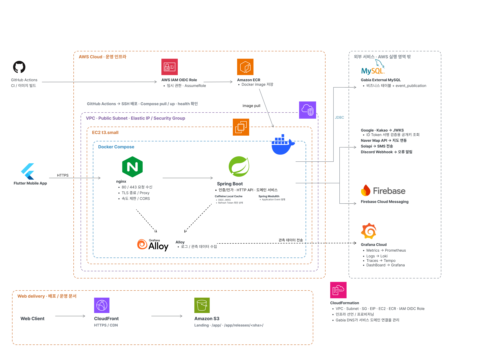
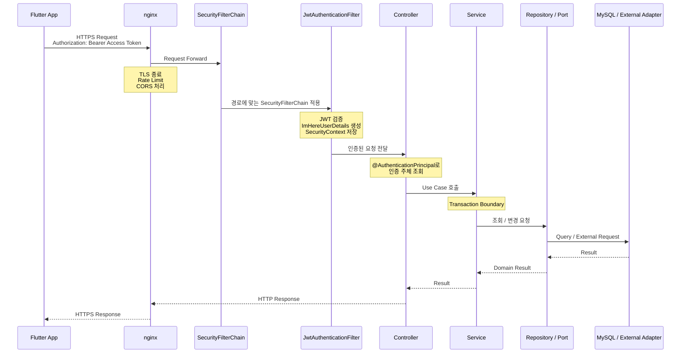
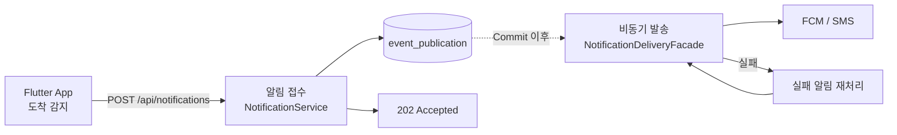
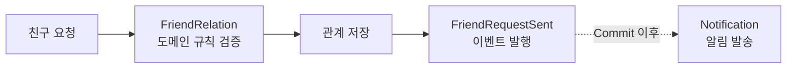
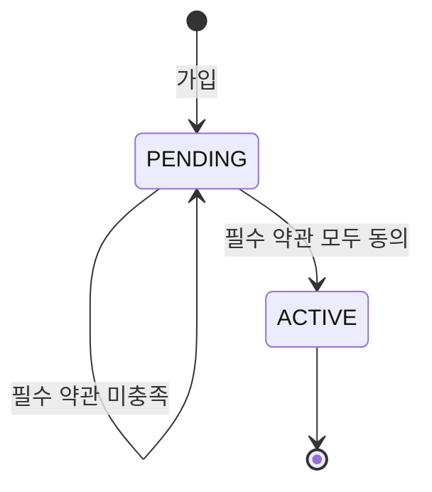
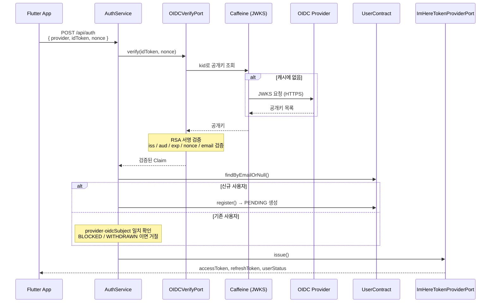

이 문서는 ImHere 서버의 구조에 대해 설명합니다.

- 해당 프로젝트에서 서버의 책임

  > 앱이 판정한 출발, 도착 사건을 받아, 관련이 있는 사람에게, 중복 없이, 외부 공급사에 구애받지 않고 끝내 전달한다.

## 1. 아키텍처 구조



- 운영 환경
    - AWS
        - `CloudFormation`
        - ec2 : `t3.small`
    - MySQL
        - 커넥션 30개
        - `250mb`
    - Grafana Cloud
        - Loki, Grafana, Prometheus, Tempo
    - Firebase
        - Cloud Messaging

## 2. 요청 흐름

### 공통



#### 인증 및 인가

- `OIDC` 사용

#### 부하 제한

- 문제
    - 한 명의 사용자가 같은 요청을 여러 번 보내도 서버에 방어 로직이 없었습니다. 때문에 단일 사용자의 과한 요청으로 인해 서버가 `EOF` 와 `5xx` 가 될 수 있고, 해당 서비스를 이용해서 대량의 스팸
      문자를 발송할 수도 있다는 문제가 존재했습니다.
- 해결 : `nginx` 와 `bucket4j`을 도입
    - `nginx` : IP당 10r/s(burst 30), 호스트 전체 100r/s(burst 100), IP당 동시 연결 20 → `429`/`503`
    - `bucket4j` : `SmsDailyRecipientRateLimiter` — 발신자당 하루 distinct 수신자 4명 제한
- 한계
    - `bucket4j` 를 로컬 캐시인 `Caffeine` 캐시를 이용해서 구현함. 이 때문에 인스턴스가 늘어나면 인당 하루 4번의 문자를 발송하는 것을 막을 수 없음.

***아래에서 언급할 내용에서는 인증 및 Nginx 관련 내용은 생략하고 애플리케이션 내부 흐름만을 다루겠습니다.***

### 2-1. 도착 알림



- 알림 발송 접수와 발송을 분리.
- 채널에 따라 FCM 또는 Solapi Adapter로 전달한다.
    - SMS 발송 요청은 일일 수신자 한도를 먼저 확인.
- `dedupeKey`를 이용해 동일 알림의 중복 발송을 방지.
- 실패한 알림은 상태를 기록하고 Recovery Scheduler가 재처리.

#### 해당 구조의 선택 이유

- 문제
    - 외부 Provider까지 하나의 트랜잭션에서 사용 시 다음과 같은 문제가 존재함.
        - 요청 스레드와 DB 커넥션 점유 시간 증가
        - 외부 Provider 지연을 통제할 수 없음.
- 해결 : 알림 접수 후 별도의 스레드에서 발송을 한다.

    ```
    PENDING ──claim──► PROCESSING ──성공──► SENT
                            │
                            ├──실패(재시도 여지)──► FAILED ──재시도 3회 초과──► DEAD
                            └──결과 불확실──────► UNKNOWN
    ```

#### 위치 추적을 서버에서 하지 않는 이유

- 서버에 실시간 위치 공유를 할 때 발생하는 문제
    - 서버에 위치를 공유하는 기능은 한국의 법으로 인해 사업자 등록증이 있는 사람이 신고를 통해 사용할 수 있음.
    - 해당 기능을 가진 앱을 구글 플레이스토어에 배포할 때 심사가 까다로워짐.
    - 서버의 처리량이 사용자의 수에 의존이 됨.
- 당시 상황
    - 서버에 위치를 공유하는 것이 이 서비스를 위한 필수 기능은 아님.
- 선택
    - 클라이언트가 Geofence로 출발·도착을 판정하고, 서버에는 이벤트만 전달

### 2-2. 친구 요청



- `friend` 모듈은 `notification` 구현체를 직접 호출하지 않고 `FriendRequestSent` 도메인 이벤트만 발행

### 2-3. 약관 동의와 사용자 활성화



- 가입 직후 사용자는 `PENDING` 상태
- 필수 약관이 모두 충족되면 `UserActivationContract`를 통해 사용자 상태를 `PENDING` → `ACTIVE`로 전환

---

## 3. 모듈 구조와 계층

### 모듈 구조

- **구조** : `Spring Modulith` 기반 모듈러 모놀리스
- **선택 이유** : AI 코딩 에이전트가 코드를 생성·수정하는 과정에서 모듈 경계와 의존 규칙이 점진적으로 훼손되는 것을 방지하기 위해 선택. 프롬프트, 하네스에 의존하는 비결정적 결과물을 Spring
  Modulith를 이용해서 결정적인 구조 검증을 통해 순환 의존, 모듈 내부 구현 접근, 허용되지 않은 모듈 의존을 테스트 단계에서 차단하기 위해 도입하였습니다.
- **참고한 자료, Spring I/O 2026** : *How Spec-Driven Development Changes the Way Teams Build Software* — 공식 세션 페이지

```
com.kdongsu5509
├── auth            인증: OIDC 검증, JWT 발급·갱신, Security 필터 체인, 관리자 로그인
├── user            사용자: 등록·조회·활성화·차단·탈퇴
├── friends         친구 관계: 요청·수락·거절·별칭·제한
├── notifications   알림: 접수 → 상태 관리 → FCM/SMS 발송 → 실패 복구
├── terms           약관 원문과 버전
├── agreement       사용자의 약관 동의 이력
├── maps            네이버 지도 API 프록시
├── admin           운영 상태 모델 (OPEN 모듈)
├── shared          공통 응답·이벤트·캐시 포트 (OPEN 모듈)
└── support         설정·예외·로깅·Discord 경보·비동기 실행기 (OPEN 모듈)
```

### 계층별 책임

- `Controller` : HTTP 입출력, 인증 주체 추출, Bean Validation, DTO 변환
- `Service` : 유스케이스 단위 트랜잭션, 도메인 객체 조합, 모듈 간 계약 호출
- `Domain` : 상태 전이 규칙(친구 관계, 알림 상태), 불변식, 알림 본문 생성
- `Repository` : DB 접근
- `Adapter` : FCM·Solapi·OIDC·네이버 호출

### 도메인별 내부 구조

- `Hexagonal` 과 `MVC` 를 함께 사용.
    - 변경 가능성이 높은 것은 `Hexagonal`, 그렇지 않은 것은 `MVC` 를 채택
- 근거
    - 외부 SDK는 바뀔 가능성이 높고 테스트에서 대체할 필요도 크다고 판단. 반면 `CRUD` 와 같은 구조를 씌우면 불필요하게 파일의 수가 늘어난다.
- 결과
    - `hexagonal architecture` : `auth` , `notification`
    - `mvc architecture` : `user`, `friends`, `terms`, `agreement`

---

## 4. Redis와 외부 Message Broker 제거 이유

#### Message Broker

- 판단 당시 상황
    - 사용자는 10명 미만인 상태.
- 판단
    - 현재 사용자는 1대의 서버 인스턴스로 감당 가능하다고 판단.
    - 다중 인스턴스 사용 혹은 많은 사용자가 있는 환경이 아님에도 사용하는 것이과도하다고 판단하였음.
- 선택
    - Spring Modulith의 Event Publication Registry 사용
        - 이미 `Spring Modulith` 를 판단 시점에 AI 제어를 위해서 도입하였음.
        - 스프링 모듈리스가 제공하는 기능이 `Outbox 패턴` 과 같은 수준을 보장해줌.

            ```yaml
            spring.modulith.events:
            completion-mode: delete                        # 처리 끝난 발행 기록은 삭제
            republish-outstanding-events-on-restart:true  # 재시작 시 미처리분 재발행
            ```

        ```
        Producer                             저장                    Consumer
        ─────────────────────────────────────────────────────────────────────────
        FriendRelationCommandService  ─┐
        UserLifecycleService           ├─► event_publication  ─┬─► NotificationEventListener
        NotificationService           ─┘     (MySQL, 업무      │
                                              데이터와 같은    └─► UserForceLogoutEventListener
                                              트랜잭션)
                                                  ┊
                                            커밋된 뒤 디스패치
        ```

- 한계
    - 다중 인스턴스 환경으로 전환이 필요한 경우, 중복, 순서 제어, 소유권 확인과 같은 로직을 재설계하여야 함.

#### Caffeine 로컬 캐시

- 당시 상황
    - 아무런 생각 없이 `Redis` 를 도입하여 사용하였음.
    - 그러나 사용자가 적어 인스턴스 1대로 충분히 처리 가능하였음.
- 선택
    - Caffeine 캐시를 채택하여 인스턴스의 읽기 속도를 높이면서 비용을 낮추는 방향을 선택.
- 한계
    - 인스턴스 확장 시 `refresh` 회전 로직과 `SMS` 한도 제한 로직을 수정하여야 함.

---

## 5. 인증과 인가

### 로그인 방식

- 당시 상황
    - 클라이언트가 Flutter 앱 하나뿐이고, 각 소셜 SDK가 이미 로그인 UI와 토큰 발급까지 처리함.
- 판단
    - 서버가 Authorization Code를 다시 교환하는 흐름을 추가하는 대신, 카카오에서 보다 안전한 로그인 처리를 위해 지원하는 OIDC를 활용해 ID Token을 서버에서 직접 검증하는 방식을
      선택함.
- 선택
    - `OIDC` 방식을 채택



#### 토큰 정책

- access token 유효 기간 : 12시간
- `refresh token` : 7일
- jwks 갱신 : `OIDCPublicKeyScheduler`가 7일 간격으로 전체 재조회
- 지원 Provider : Google, Kakao
    - Google은 `iss`를 스킴 포함/미포함 두 형태로 발급하고, Google은 플랫폼마다 `aud`가 다름.
    - 이 때문에 `application.yaml`의 `issuers`/`audiences`를 단일 값이 아닌 **목록**으로 관리.

#### **SecurityFilterChain**

- `SecurityConfig`가 필터 체인 세 개를 순서대로 등록.

| 순서          | 대상                    | 세션                    | 통과 조건                                                  |
|-------------|-----------------------|-----------------------|--------------------------------------------------------|
| `@Order(1)` | `/admin`, `/admin/**` | `IF_REQUIRED` (세션 사용) | `ROLE_ADMIN`. 단 `/admin/login`, `/admin/assets/**`는 공개 |
| `@Order(2)` | `/api/admin/**`       | `STATELESS`           | JWT + `ROLE_ADMIN`                                     |
| `@Order(3)` | 나머지 `/api/**`         | `STATELESS`           | JWT 인증                                                 |

- 관리자 화면(`/admin`)만 세션을 쓰는 이유
    - `thymeleaf` 를 사용. 이 때문에 jwt 저장할 곳이 마땅치 않음.

### 관리자 인증

- 문제
    - 관리자 계정은 소셜 로그인 대상이 아니며, 비밀번호 하나만으로는 탈취 시 바로 뚫림.
- 선택
    - 비밀번호 해시 + TOTP 2단계 (`admin.mobile.*` 설정).
    - `AdminLoginAttemptService`가 `(관리자 ID, 클라이언트 IP)` 단위로 실패를 세고, 5회 실패 시 7일간 차단.
- 한계
    - 차단 상태 역시 Caffeine 로컬 캐시에 있음. 인스턴스가 늘어나거나 재시작하면 실패 횟수가 초기화됨.

---

## 6. 외부 시스템 연동

### 외부 호출과 트랜잭션 경계

- 문제
    - 외부 API 호출이 DB 트랜잭션 안에 있으면, 공급사가 느려질 때 커넥션을 쥔 채로 대기함. 커넥션 풀이 금방 마름.
- 선택
    - 트랜잭션을 짧게 쪼개고, 외부 호출 구간에는 트랜잭션을 걸지 않음.

```
사용자 요청 트랜잭션
    ├── 업무 데이터 저장
    └── event_publication 기록
         ▼ COMMIT
리스너 (트랜잭션 밖)
    ├── register()                           REQUIRES_NEW  ← 짧은 트랜잭션
    ├── claimForDelivery()                   REQUIRES_NEW  ← 짧은 트랜잭션
    ├── FCM / Solapi 호출                     트랜잭션 없음  ← 여기서 오래 걸려도 무해
    └── markAsSent / markFailed / markDead   REQUIRES_NEW  ← 짧은 트랜잭션
```

- `NotificationService.redeliver()`와 `redeliverAll()`은 `Propagation.NOT_SUPPORTED`로 선언해 트랜잭션을 걸치지 않게 함.
- 한계
    - 트랜잭션이 여러 개로 쪼개져 중간에 프로세스가 죽으면 상태가 어중간하게 남음. 이 구간은 Recovery Scheduler가 메움.

### 타임아웃 순서

- 문제
    - 부하 시험에서 5xx가 발생했을 때, 애플리케이션 실패인지 게이트웨이 타임아웃인지 구분되지 않음. HikariCP `connection-timeout` 기본값과 nginx
      `proxy_read_timeout`이 둘 다 30초였음.
- 선택
    - Hikari `connection-timeout`을 5초로 낮추고 nginx는 30초 유지. 커넥션이 고갈되면 **앱이 먼저 명확한 예외를 남기고** 끝나도록 순서를 고정.
- 결과
    - 이후 실행에서 애플리케이션 upstream 5xx 0건, 나머지 5xx는 nginx 동시 연결 제한(503)으로 분리 집계됨.

---

## 7. 지금 구조의 한계

1. 단일 인스턴스
    - 현재 모든 구조가 단일 인스턴스 전제로 설계되었음. 다중 인스턴스가 될 경우, 변경이 필요
        - Caffeine 로컬 캐시, 인메모리 rate limit, 단일 JVM 이벤트
2. 중복 발송 가능성
    - `dedupeKey`가 같은 알림의 재예약은 막지만, "외부 전송은 성공했는데 상태를 저장하기 직전에 프로세스가 죽는" 경우는 재시도 때 중복 발송이 가능함
3. Event Publication Registry 의 한계
    - 알림 한 건이 `notification` INSERT/UPDATE와 `event_publication` INSERT/UPDATE/DELETE를 함께 생성.
    - 부하 테스트에서 요청 1건당 평균 약 3.9회 커밋이 발생함.
