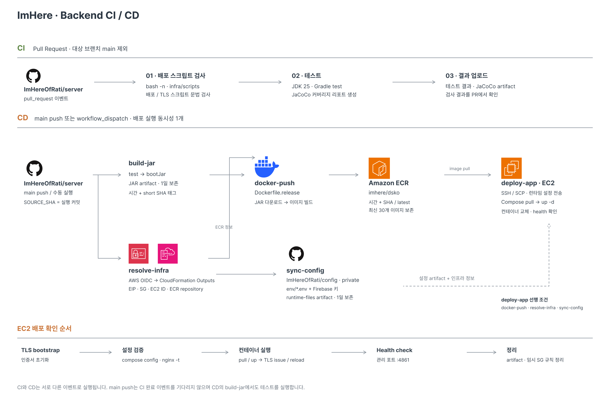

해당 문서에서는 ImHere 서버가 어떻게 빌드되고, 어떻게 EC2까지 가고, 떠 있는 동안 어떻게 관측·대응하는지를 설명합니다.

## 1. AWS 운영 환경

**CloudFormation 사용 :** `imhere-prod-infra`, `infra/cloudformation/main.yaml` 참고.

- **VPC**
    - `10.50.0.0/16`
- **Public Subnet**
    - `10.50.1.0/24`
    - Internet Gateway
    - 기본 라우트 구성
- **EC2**
    - Amazon Linux 2023
    - SSM Parameter Store를 통해 최신 AMI 조회
    - 기본 인스턴스 타입 `t3.small`
        - 운영 컨테이너의 `mem_limit` 합을 약 1.43 GiB로 설정함.
            - 실제 운영 환경에서 호스트 OS와 Docker daemon의 메모리 사용량을 함께 측정해 2 GiB 메모리 내에서 운영 가능하다고 판단함.
            - 차후 메모리 사용량이 85% 이상이 지속됨을 관측되면, scale-up을 고려
- **Elastic IP**
    - EC2에 고정 공인 IP 할당
    - CD에서 해당 IP를 배포 대상 host로 사용
- **Security Group**
    - 평상시 인바운드는 `80`, `443`만 허용
    - `22` 포트는 배포 중에만 GitHub Actions Runner IP에 임시 허용
- **ECR**
    - Repository: `imhere/dsko`
    - 이미지 push 시 스캔
    - AES256 암호화
    - 최신 이미지 30개 보존
- **IAM OIDC Provider + Role**
    - GitHub Actions가 장기 AWS Access Key 없이 AWS에 접근
    - OIDC를 통해 임시 자격증명 발급

## 2. CI, CD



### CI — Pull Request

- 조건
    - `pull request` 생성 시 동작.
- 동작
    1. checkout
    2. JDK 25 (corretto) 설정
    3. Gradle 캐시 복원
    4. 배포 스크립트 문법 검사 — `bash -n`으로 `infra/scripts/` 아래 셸 스크립트를 전부 검사
        1. 셸 오타 하나로 배포가 EC2에서 반쯤 진행된 채 죽는 것을 막기 위해 도입
    5. `./gradlew test`
    6. `if: always()`로 테스트 리포트와 JaCoCo 커버리지를 artifact 업로드

### CD

```
   ┌────────────┐      ┌───────────────┐
   │ build-jar  │      │ resolve-infra │     ← 둘이 동시에 시작
   │ test+bootJar│     │  CFN Outputs  │
   └─────┬──────┘      └───┬───────┬───┘
         │                 │       ▼
         │                 │  ┌────────────┐
         │                 │  │ sync-config│  ← private config repo clone
         │                 │  └─────┬──────┘
         ▼                 ▼        │
   ┌─────────────────────────┐      │
   │      docker-push        │      │
   │ Dockerfile.release→ECR  │      │
   └───────────┬─────────────┘      │
               ▼                    │
   ┌────────────────────────────────┴──┐
   │            deploy-app              │
   └────────────────────────────────────┘
```

- 조건
    - `main` push
- 동작
    - main push (또는 수동 실행)

    1. 테스트 + `bootJar`
    2. 이미지 태그 생성 — `20260915-2131-b969557` (KST 시각 + short SHA)
    3. CloudFormation 출력값에서 배포 대상 조회
    4. private config 저장소에서 `env/*.env`, Firebase 키 확보
    5. `Dockerfile.release`로 이미지 빌드 → ECR push (불변 태그 + `latest`)
    6. SSH 배포 — 설정 전송, 컨테이너 교체, TLS 발급
    7. 헬스체크 통과해야 성공, 실패하면 배포 실패로 종료
- 참고 사항
    - `cancel-in-progress: false` ****을 적용하여 진행 중인 배포를 중간에 끊지 않도록 함. ****

    ```yaml
    concurrency:
    group: imhere-production-deploy
    cancel-in-progress:false
    ```


- **`prod` 프로필의 필수 환경변수로 잘못된 기본값 차단**
    - 구성
        - 운영 필수 환경변수를 기본값 없이 선언.
        - 값이 누락되면 애플리케이션 기동 단계에서 즉시 실패.
        - DB 설정 오류는 Hikari 연결 및 `ddl-auto=validate` 단계에서 검증.
    - 방지하는 실패
        - JWT Secret이나 Actuator 경로가 개발용 기본값으로 운영되는 상황 방지.
        - 설정 누락이 장애로 드러나지 않고 운영에 반영되는 문제 차단.
- **`compose config`와 `nginx -t`로 배포 전 설정 검증**
    - 구성
        - 기존 컨테이너를 교체하기 전에 `docker compose config` 실행.
        - 렌더링된 nginx 설정을 `nginx -t`로 검증.
        - 필수 템플릿 변수가 비어 있으면 렌더링 단계에서 실패.
    - 방지하는 실패
        - 잘못된 환경변수 보간으로 Compose 실행이 실패하는 상황 방지.
        - 기존 컨테이너를 내린 뒤 nginx 설정 오류를 발견하는 상황 방지.
- **Self-Signed Bootstrap으로 TLS 초기 배포 의존성 해소**
    - 구성
        - 실제 인증서가 없으면 self-signed 인증서를 먼저 생성.
        - nginx 기동 후 Let’s Encrypt HTTP-01로 실제 인증서 발급.
        - 발급 완료 후 nginx reload.
    - 방지하는 실패
        - 인증서가 없어 nginx를 실행할 수 없고, nginx가 없어 인증서를 발급할 수 없는 초기 배포 순환 의존성 해소.
- **Security Group 동적 제어로 SSH 상시 개방 방지**
    - 구성
        - 배포 시 GitHub Actions Runner의 공인 IP 조회.
        - `<Runner IP>/32`에 대해서만 22번 포트를 임시 허용.
        - 배포 결과와 관계없이 `if: always()`에서 규칙 제거.
        - AWS 인증은 OIDC AssumeRole 사용.
        - IAM Trust Policy를 `main` 브랜치로 제한.
    - 방지하는 실패
        - SSH 포트 상시 노출 방지.
        - 장기 AWS Credential 유출 위험 축소.
        - 배포 실패 후 임시 Security Group 규칙이 남는 상황 방지.
- **컨테이너별 `env_file` 분리로 Secret 노출 범위 제한**
    - 구성
        - `server.env`, `nginx.env`, `alloy.env`로 환경변수 분리.
        - 각 컨테이너에 필요한 Secret만 주입.
        - 배포 성공 후 EC2의 `env/*.env` 삭제.
    - 방지하는 실패
        - 하나의 컨테이너 침해가 전체 운영 Secret 노출로 이어지는 범위 축소.
        - 배포 완료 후 호스트 디스크에 불필요한 Secret이 남는 상황 방지.
- **Health Check로 애플리케이션 기동 실패 감지**
    - 구성
        - 배포 마지막에 `remote-healthcheck.sh` 실행.
        - nginx 컨테이너에서 애플리케이션 `/health` 엔드포인트 호출.
        - 최대 10회, 30초 간격으로 `"status":"UP"` 확인.
        - 실패 시 최근 로그 200줄을 출력하고 배포 실패 처리.
    - 방지하는 실패
        - `docker compose up -d`는 컨테이너 실행 여부만 확인하므로 애플리케이션 기동 실패를 놓칠 수 있음.
        - 환경변수 누락이나 `ddl-auto=validate` 실패 상태에서 CD가 성공으로 끝나는 상황 방지.
- **`mem_limit`으로 컨테이너별 메모리 상한 설정**
    - 구성
        - `dsko`: `1200m`
        - `nginx`: `64m`
        - `alloy`: `300m`
        - Docker cgroup을 통해 컨테이너별 메모리 사용량 제한.
    - 방지하는 실패
        - JVM 또는 특정 컨테이너의 메모리 사용 증가가 호스트 전체 메모리 고갈로 확산되는 위험 감소.
        - 호스트 OOM Killer가 다른 프로세스까지 종료하는 상황 방지.

## 3. 운영 안정성

- **nginx IP Rate Limit과 Bucket4j 사용자 제한으로 자원 고갈 방지**
    - 핵심 효과
        - 비정상적인 요청은 애플리케이션에 도달하기 전에 차단.
        - 비용이 발생하는 SMS 요청은 사용자 단위로 별도 제한.
        - 한 사용자가 작은 인스턴스의 자원을 독점하는 상황 방지.
    - 구성
        - `nginx`에서 IP 기준 `10 req/s`, `burst=30`으로 요청 속도 제한.
        - 전체 API 트래픽은 `100 req/s`, `burst=100`으로 제한.
        - IP당 동시 연결은 최대 20개로 제한.
        - 요청 속도 초과는 `429`, 동시 연결 초과는 `503`으로 분리.
        - Bucket4j에서 사용자 기준 하루 SMS 수신자 4명으로 제한.
    - 두 계층으로 분리한 이유
        - `nginx`는 애플리케이션에 도달하기 전에 비정상적인 요청 속도를 제한.
        - `Bucket4j`는 IP가 아닌 인증된 사용자를 기준으로 비용이 발생하는 SMS 사용량을 제한.
        - `burst=30`은 정상 사용자 순간 최대 8건과 공유 IP 환경을 고려해 설정.
    - 확인한 결과
        - 사용자 단위 제한 적용 후 동일 부하 시나리오에서 요청의 96%를 `429`로 즉시 차단.
        - 기존에 발생하던 네트워크 오류를 0건으로 감소.
- **Hikari와 nginx 타임아웃 순서로 장애 원인 분리**
    - 핵심 효과
        - DB 커넥션 고갈 시 `nginx` 504로 가려지기 전에 애플리케이션에서 원인을 확인할 수 있음.
        - 애플리케이션 장애와 Proxy 계층 장애를 구분해 관측 가능.
    - 구성
        - `nginx proxy_connect_timeout`: `3s`
        - `nginx proxy_read_timeout`: `30s`
        - `nginx proxy_send_timeout`: `30s`
        - Hikari `connection-timeout`: `5s`
    - 방지하는 실패
        - DB 커넥션 획득 실패가 `nginx` 타임아웃으로 뭉뚱그려지는 상황 방지.
    - 확인한 결과
        - 조정 전에는 5xx 발생 원인을 애플리케이션과 `nginx` 사이에서 구분하기 어려웠음.
        - 조정 후 애플리케이션 upstream 5xx `0건`, nginx 동시 연결 제한 503 `20~24건`으로 분리 확인.
- **nginx에서 HTTP → HTTPS와 Canonical Domain 라우팅 통합**
    - 핵심 효과
        - 실제 서비스 진입점을 HTTPS apex 도메인 하나로 통일.
        - HTTP 및 `www` 요청을 일관된 주소로 정규화.
    - 구성
        - 80 포트에서 `/.well-known/acme-challenge/`만 HTTP로 제공.
        - 나머지 HTTP 요청은 HTTPS로 `301` 리다이렉트.
        - `www.${SERVER_NAME}` 요청은 `${SERVER_NAME}`으로 `301` 리다이렉트.
        - 실제 애플리케이션 트래픽은 HTTPS apex 도메인에서 처리.
        - `proxy_pass`는 애플리케이션 컨테이너 이름을 직접 사용.
    - 방지하는 실패
        - HTTP와 HTTPS가 동시에 서비스되는 구성 방지.
        - `www`와 apex 도메인으로 접근 경로가 분산되는 문제 방지.
        - Docker 네트워크 재생성 이후 upstream 주소가 달라지는 상황을 줄임.
- **nginx에서 CORS 응답을 일원화**
    - 핵심 효과
        - CORS 정책의 책임을 nginx 한 곳으로 통일.
        - Preflight 요청을 애플리케이션까지 전달하지 않아 불필요한 요청 처리 감소.
    - 구성
        - `/api/`의 `Access-Control-Allow-Origin`을 `${NGINX_ALLOWED_ORIGIN}`으로 제한.
        - `proxy_hide_header`로 Spring에서 전달되는 중복 CORS 헤더 제거.
        - `OPTIONS` Preflight 요청은 백엔드로 전달하지 않고 nginx에서 `204` 반환.
        - Credential을 사용하므로 Origin을 대신 명시적으로 제한.
        - `Vary: Origin` 헤더 유지.
    - 방지하는 실패
        - nginx와 Spring이 동시에 CORS 헤더를 만들어 중복되는 문제 방지.
        - 허용되지 않은 Origin에서 Credential 요청이 들어오는 문제 방지.
- **Forwarded Header 전달로 원본 요청 정보 유지**
    - 핵심 효과
        - Reverse Proxy를 거쳐도 클라이언트 IP와 원래 프로토콜 정보를 애플리케이션에서 확인 가능.
    - 구성
        - nginx에서 `X-Real-IP`, `X-Forwarded-For`, `X-Forwarded-Proto` 전달.
        - Spring Boot는 `server.forward-headers-strategy: native`로 Proxy Header 처리.
    - 방지하는 실패
        - 애플리케이션이 모든 요청의 IP를 nginx 컨테이너 주소로 인식하는 문제 방지.
        - HTTPS 요청을 내부 HTTP 요청으로 잘못 판단하는 문제 방지.

## 4. 관측 (Observability)

### **전체 구성**

- EC2에서는 Grafana Alloy 컨테이너 하나만 운영.
- `Prometheus`, `Loki`, `Tempo`, `Grafana`는 모두 `Grafana Cloud` 사용.
- 애플리케이션 자원과 관측 백엔드 자원을 분리해 `t3.small`의 자원을 애플리케이션에 집중.

```
Spring Boot
   ├─ Metrics
   │    └─ /prometheus :4861
   │         └─ Alloy scrape (15s)
   │              └─ Grafana Cloud Prometheus
   │
   ├─ Traces
   │    └─ OTLP HTTP :4318
   │         └─ Alloy
   │              └─ Grafana Cloud Tempo
   │
   └─ Logs
        └─ stdout / stderr
             └─ Docker socket
                  └─ Alloy
                       └─ Grafana Cloud Loki

별도 알림
   └─ 4xx / 5xx
        └─ Application
             └─ Discord Webhook
```

#### **Metrics — Spring Boot → Alloy → Prometheus**

- 수집 대상
    - `iamhere-server-container:4861${MGMT_BASE_PATH}/prometheus`
- 수집 주기
    - 15초.
- 역할
    - Spring Boot Actuator가 메트릭 노출.
    - Alloy가 scrape.
    - Grafana Cloud Prometheus로 remote write.

#### **Logs — Docker stdout → Alloy → Loki**

- 수집 대상
    - 애플리케이션.
    - nginx.
    - Alloy.
- 수집 방식
    - `discovery.docker`로 컨테이너 탐색.
    - `imhere_log_scope` 라벨 기준으로 수집.
    - Docker `stdout/stderr`만 수집.
- 가공
    - Spring Boot ECS JSON 로그 구조화.
    - nginx JSON 로그 파싱.
    - `trace.id`, `status`, `durationMs`를 메타데이터로 승격.
    - Alloy 자신의 `loki.write` 관련 로그는 제외해 재수집 루프 방지.

#### **Traces — Spring Boot → Alloy → Tempo**

- 수신
    - OTLP gRPC `4317`.
    - OTLP HTTP `4318`.
- 처리
    - `memory_limiter`
    - `batch`
- 전송
    - Grafana Cloud Tempo.
    - OTLP HTTP exporter 사용.
- 선택 이유
    - Grafana Cloud Tempo 엔드포인트가 OTLP HTTP Gateway 형태.
    - `gRPC exporter` 사용 시 endpoint resolver 오류가 발생해 HTTP 방식으로 변경.

#### **Actuator — 관리 포트와 경로 분리로 외부 노출 제한**

- 노출 엔드포인트
    - `health`
    - `prometheus`
    - `info`
- 보호 방식
    - 관리 포트 `4861` 분리.
    - `${MGMT_BASE_PATH}` 사용.
    - Security Group으로 접근 제한.

#### **Discord — 주요 오류를 관측 백엔드와 별도로 즉시 알림**

- `SERVER_ERROR`
    - HTTP status `500` 이상.
    - 알림 전달 실패.
- `CLIENT_ERROR`
    - 지정한 클라이언트 오류.
- 실행 방식
    - `@Async("discordExecutor")`
    - 요청 처리와 알림 전송 분리.
- 한계
    - 전송 실패 시 재시도하지 않음.
    - `logger.error`만 기록.

## 7. 이 구성의 한계

현재 구조는 1인 개발 환경에서 운영 복잡도를 과도하게 늘리지 않으면서 필요한 수준의 안정성을 확보하는 것을 우선했습니다.

- **무중단 배포를 지원하지 않음**
    - 현재 상태
        - Blue/Green, 포트 스위칭, 다중 upstream 구성이 없음.
        - 배포 시 기존 애플리케이션 컨테이너를 새 컨테이너로 교체.
        - nginx upstream health check도 사용하지 않음.
    - 도입하지 않은 이유
        - Blue/Green을 적용하면 배포 경로, 포트 전환, 상태 확인 등 관리해야 할 요소가 크게 늘어남.
        - 현재 규모에서는 짧은 배포 중단을 감수하고, Health Check로 실패를 빠르게 감지하는 구조가 더 단순하다고 판단.
    - 영향
        - 새 컨테이너가 기동될 때까지 요청을 처리할 애플리케이션이 없는 구간이 발생할 수 있음.
        - 실제 중단 시간과 요청 유실 여부는 아직 측정하지 않음.
- **Health Check 실패 시 자동 롤백하지 않음**
    - 현재 상태
        - ECR에서 최근 이미지 30개를 보존.
        - 이미지 태그는 `<YYYYMMDD-HHMM>-<short sha>`와 `latest` 사용.
        - 이전 이미지를 다시 pull해 수동 복구 가능.
        - Health Check 실패 시 CD만 실패하고 이전 버전으로 자동 복구하지 않음.
    - 도입하지 않은 이유
        - 자동 롤백은 실패 조건, 이전 버전 선택, DB 스키마 호환성까지 함께 관리해야 함.
        - 현재는 자동화된 복구보다 실패를 확실히 감지하고 이전 이미지로 되돌릴 수 있는 경로를 확보하는 것을 우선함.
    - 복구 방법
        - 정상 커밋으로 CD 재실행.
        - 또는 이전 ECR 태그를 지정해 수동 재배포.
    - 한계
        - 이전 이미지 배포 시 `docker-compose.yml` 수정이 필요.
        - 실제 장애를 가정한 롤백 리허설은 아직 수행하지 않음.
- **런타임 Secret을 전용 Secret Store에서 관리하지 않음**
    - 현재 상태
        - `EC2_SSH_PRIVATE_KEY`를 GitHub Secrets에 보관.
        - Private Config Repository 접근에 `CONFIG_REPO_PAT` 사용.
        - Firebase 서비스 계정 키는 EC2 디스크에 유지.
        - 운영 설정 원본은 Private Git Repository.
    - 도입하지 않은 이유
        - 운영 Secret을 관리하는 주체가 개발자 1명이라 별도의 권한 위임이나 팀 단위 Secret 공유가 필요하지 않음.
        - 현재는 GitHub Secrets와 Private Repository만으로 접근 경로와 변경 주체를 충분히 제한할 수 있음.
        - Secrets Manager나 SSM Parameter Store를 추가했을 때 얻는 관리 이점보다 IAM·조회 경로 등 관리 요소가 늘어나는 비용이 더 크다고 판단.
    - 영향
        - 장기 Credential을 직접 관리해야 함.
        - Firebase 키는 EC2 호스트가 침해되면 노출될 수 있음.
    - 개선 후보
        - 운영 인원이 늘어나거나 Secret 회전·권한 분리가 필요해지면 Secrets Manager 또는 SSM Parameter Store 도입.
        - SSM Session Manager로 SSH Key 의존 제거.
- **단일 애플리케이션 인스턴스에 의존**
    - 현재 상태
        - 애플리케이션 인스턴스가 1대.
        - Load Balancer와 대체 인스턴스가 없음.
    - 도입하지 않은 이유
        - 현재 측정된 처리량에서는 수평 확장이 필요한 수준의 부하가 확인되지 않음.
        - 다중 인스턴스로 전환하면 Load Balancer뿐 아니라 캐시, Rate Limit, 이벤트 처리 등 로컬 상태를 분산 환경에 맞게 다시 설계해야 함.
        - 실제 병목도 애플리케이션 인스턴스 수보다 DB 커넥션에서 먼저 확인돼 우선순위가 낮다고 판단.
    - 영향
        - 애플리케이션 컨테이너 또는 EC2가 중단되면 서비스 전체가 중단됨.
- **Docker 자체 Health Check가 없음**
    - 현재 상태
        - Dockerfile 또는 Compose의 `HEALTHCHECK`를 사용하지 않음.
        - 배포 시 `remote-healthcheck.sh`로 애플리케이션 정상 여부를 확인.
    - 도입하지 않은 이유
        - 현재 Docker Compose에는 unhealthy 상태를 기준으로 자동 교체하거나 트래픽을 우회할 Orchestrator가 없음.
        - 동일한 Health Check를 여러 계층에 중복하기보다 CD의 HTTP 검증 하나로 판정 기준을 통일.
    - 영향
        - 배포 이후 애플리케이션이 응답하지 않는 상태를 Docker 자체에서는 판단하지 못함.
